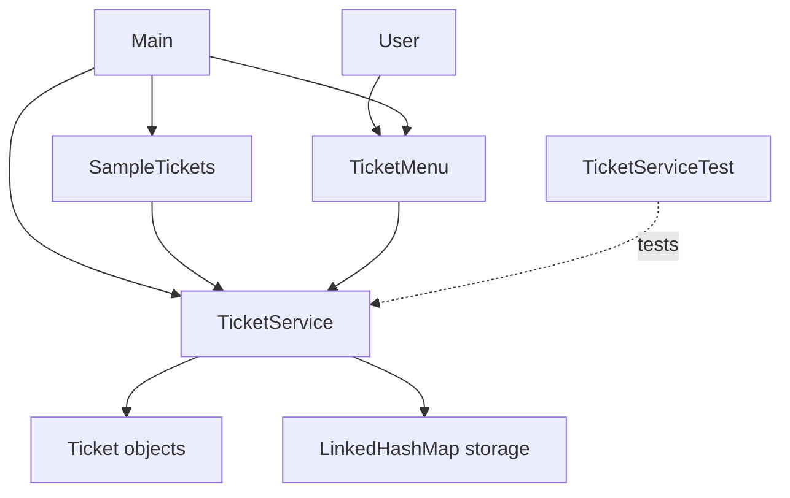

# Simple Ticket Management System

A console-based Java application for managing IT support tickets. This project was developed as a Java Core learning exercise, focusing on object-oriented programming, collections, business rules, input validation, exception handling and automated unit testing.

## Features

- Create, view, search, update and delete tickets (CRUD).
- Search for a ticket by its unique ID.
- Filter tickets by status or priority.
- Change the status of an existing ticket.
- Sort tickets by creation date, from oldest to newest or in reverse order.
- Validate input and handle duplicate or missing ticket IDs.
- Load sample tickets for interactive demonstrations.

## Technologies

| Technology | Purpose |
| --- | --- |
| Java 21 | Application development |
| Apache Maven | Dependency management, compilation, testing and packaging |
| JUnit Jupiter 5.11.4 | Unit testing |
| Java Collections Framework | In-memory ticket storage and filtering |
| Gson 2.11.0 | Dependency declared in `pom.xml`; not required by the current in-memory ticket flow |

## Getting started

### Prerequisites

- JDK 21
- Apache Maven
- Git

Check your environment:

```bash
java -version
mvn -v
```

### Clone and build

```bash
git clone https://github.com/Hasanov070/Simple-Ticket-Management-System.git
cd Simple-Ticket-Management-System
mvn clean package
```

The build produces `target/ticket-management-system-1.0-SNAPSHOT.jar`.

### Run the application

Open the project in IntelliJ IDEA as a Maven project and run `az.example.tickets.Main`.

Alternatively, after building, run the compiled main class from the project root:

```bash
java -cp target/classes az.example.tickets.Main
```

This command uses the current in-memory implementation, which does not require Gson at runtime. The current Maven configuration does not declare an executable JAR manifest, so `java -jar` is not the documented launch method.

## Console menu

The application provides an Azerbaijani-language console interface. The available operations are:

| Option | Operation |
| --- | --- |
| 1 | Create a ticket |
| 2 | Display all tickets |
| 3 | Find a ticket by ID |
| 4 | Filter by status |
| 5 | Filter by priority |
| 6 | Change ticket status |
| 7 | Delete a ticket |
| 8 | Sort tickets by creation time |
| 9 | Update ticket title, description and priority |
| 0 | Exit |

## Project structure

The main packages and classes are organized as follows (selected files):

```text
Simple-Ticket-Management-System/
├── pom.xml
├── README.md
├── LEARNING_NOTES.md
└── src/
    ├── main/java/az/example/tickets/
    │   ├── Main.java
    │   ├── SampleTickets.java
    │   ├── entity/
    │   │   └── Ticket.java
    │   ├── enums/
    │   │   ├── TicketStatus.java
    │   │   └── TicketPriority.java
    │   ├── exception/
    │   │   ├── DuplicateTicketException.java
    │   │   └── TicketNotFoundException.java
    │   └── service/
    │       ├── TicketService.java
    │       └── TicketMenu.java
    └── test/java/az/example/tickets/service/
        └── TicketServiceTest.java
```

The test location follows the standard Maven layout; place the local test class there if necessary.

### Class responsibilities

| Class | Responsibility |
| --- | --- |
| `Main` | Creates the service, loads sample data and starts the console menu. |
| `TicketMenu` | Reads user input, calls service methods and displays results. |
| `TicketService` | Manages ticket operations, business rules, filtering and sorting. |
| `Ticket` | Represents a ticket and controls changes to its fields. |
| `SampleTickets` | Populates the service with demonstration data. |
| `TicketStatus`, `TicketPriority` | Define supported status and priority values. |
| Custom exceptions | Represent duplicate IDs and tickets that cannot be found. |



The application stores tickets in a `LinkedHashMap<Long, Ticket>`. It does not currently rely on a database or durable persistence. Tickets created during a session are not retained when the application exits; sample data is loaded again at startup.

## Ticket model and business rules

Each ticket has an ID, title, description, status, priority and creation timestamp.

| Status | Meaning |
| --- | --- |
| `OPEN` | A new or open ticket |
| `IN_PROGRESS` | A ticket being worked on |
| `CLOSED` | A closed ticket |

Priority levels: `LOW`, `MEDIUM`, `HIGH`.

The intended rule in the local revision is that every new ticket created through `TicketService` starts with `OPEN` status. Creation and status changes are separate operations. An existing ticket can be assigned a supported status through the status-change method. Duplicate IDs and invalid values are rejected according to the implemented validation rules. ID and creation time are not reassigned after creation.

### Example of the revised service API

```java
TicketService ticketService = new TicketService();
Ticket ticket = ticketService.createTicket(
        2001L, "Network issue", "Wi-Fi is unavailable", TicketPriority.HIGH
);
ticketService.changeTicketStatus(2001L, TicketStatus.IN_PROGRESS);
```

### Main service operations

| Method | Purpose |
| --- | --- |
| `createTicket(id, title, description, priority)` | Create a ticket with the default OPEN status (local revision). |
| `getAllTickets()` | Return a list of all tickets. |
| `getTicketById(id)` | Retrieve a ticket by ID. |
| `getTicketByStatus(status)` | Filter by status. |
| `getTicketsByPriority(priority)` | Filter by priority. |
| `changeTicketStatus(id, status)` | Change an existing ticket's status. |
| `updateTicket(id, title, description, priority)` | Update ticket details. |
| `deleteTicket(id)` | Remove a ticket. |
| `getTicketsSortedByCreatedAt()` | Return tickets in ascending creation-time order. |

## Unit testing

The test suite prepared for the local revision covers eight scenarios using JUnit 5 and the Arrange–Act–Assert pattern:

| Test scenario | Expected behavior |
| --- | --- |
| Create a ticket | Fields are correct and the initial status is OPEN. |
| Change status | An existing ticket's status is updated. |
| Update ticket | Editable fields change while the ID and status are preserved. |
| Delete ticket | The ticket is removed. |
| Missing ticket | `TicketNotFoundException` is thrown. |
| Duplicate ID | `DuplicateTicketException` is thrown. |
| Filter by status | Only tickets with the requested status are returned. |
| Filter by priority | Only tickets with the requested priority are returned. |

Run the tests:

```bash
mvn test
```

Expected summary for the eight-test suite:

```text
Tests run: 8, Failures: 0, Errors: 0, Skipped: 0
```

This is the target result, not a verified test execution report. A successful initial build was recorded; the final test and build results must be verified after the local changes. If Maven does not discover the JUnit 5 tests, check the Surefire configuration and ensure all test classes are in the Maven test source directory.

## Quick demonstration

1. Run `Main` and display all sample tickets using option 2.
2. Create a ticket with ID `2001` using option 1 and verify its OPEN status.
3. Find the ticket by ID, then change its status using option 6.
4. Filter by status and priority using options 4 and 5.
5. Update its details, sort the ticket list and delete the ticket.
6. Demonstrate duplicate-ID or missing-ticket error handling and exit.
7. Run `mvn test` to demonstrate the automated tests.

## Learning outcomes

This project demonstrates Java classes and objects, encapsulation, constructors, enums, object references, collections, enhanced for-loops, comparators, custom exceptions, input validation, Maven and JUnit 5. Additional notes and code review explanations are available in [LEARNING_NOTES.md](LEARNING_NOTES.md).

## Revision status

This README documents the intended local revision discussed during code review. The public repository, when inspected, still exposed the earlier five-parameter `createTicket` API. Commit and push the updated service, callers and tests together with this documentation after confirming the final build and test results.

**Repository:** https://github.com/Hasanov070/Simple-Ticket-Management-System
